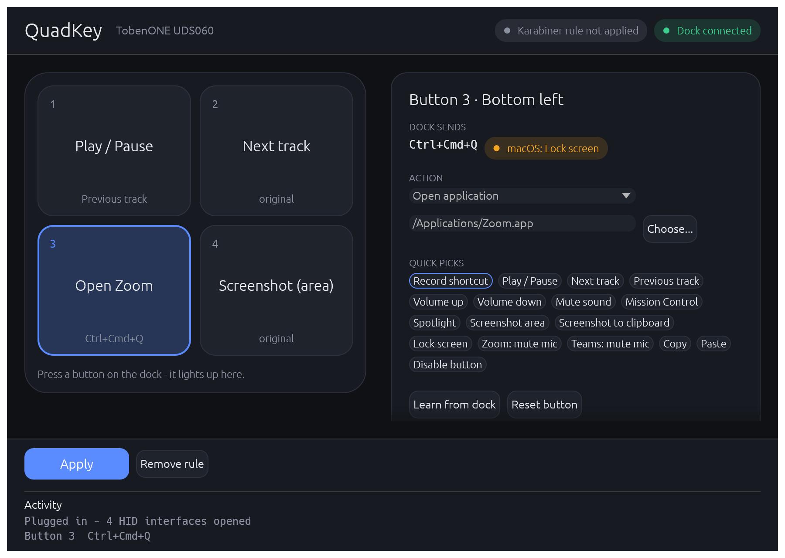

# QuadKey

Configure the four buttons of the **TobenONE UDS060** USB dock on **macOS and Linux** — the vendor only ships software for Windows.



Out of the box the dock's buttons send *Previous track*, *Next track*, **Ctrl+Cmd+Q** (locks the Mac) and **Shift+Cmd+4** (screenshot). QuadKey lets you give each button any action you like:

- **Media keys** — play/pause, next/previous, volume, mute, brightness
- **Keyboard shortcuts** — pick one, or press **Record shortcut** and type it
- **Open an application** or **run a shell command**
- **Do nothing** — for buttons you keep pressing by accident
- One-click **quick picks**: Mission Control, Spotlight, screenshot, lock screen, mute the mic in Zoom/Teams, copy/paste…

The cube in the window lights up when you press a button on the dock, so you always see which button is which. **Learn from dock** re-assigns a tile if your dock's buttons are configured differently.

> Not affiliated with TobenONE. The dock is identified by its USB IDs (`fff1:00c2`); other docks that use the same chip may work too.

## How it works

QuadKey does not reprogram the dock itself — the dock's own configuration channel is encrypted. Instead it tells your operating system's input remapper to translate what the dock sends, **for this device only** (your keyboard is never affected):

| | Remapper | What QuadKey writes |
|---|---|---|
| macOS | [Karabiner-Elements](https://karabiner-elements.pqrs.org/) | a rule in `~/.config/karabiner/karabiner.json`, limited to vendor `0xFFF1` / product `0x00C2`; your other rules are kept and a backup is made |
| Linux | [keyd](https://github.com/rvaiya/keyd) | `/etc/keyd/quadkey.conf` with `[ids] fff1:00c2`, applied with `pkexec` |

Because the remapper takes over the dock, the factory shortcuts (lock screen, screenshot) no longer reach the system once you click **Apply**.

## Install

```bash
cargo install --git https://github.com/lazarvgd/quadkey
quadkey
```

### macOS

1. Install **Karabiner-Elements** and finish its setup (driver approval).
2. Allow your terminal (or QuadKey) under **System Settings → Privacy & Security → Input Monitoring**, so QuadKey can see the dock's keyboard interface.
3. Start QuadKey, set the actions, click **Apply**.

### Linux

```bash
sudo apt install keyd           # or your distribution's package
sudo systemctl enable --now keyd
# let your user read the dock (needed for the live view and for "Open application"/"Run command")
sudo cp linux/70-quadkey.rules /etc/udev/rules.d/ && sudo udevadm control --reload && sudo udevadm trigger
```

On Linux, *Open application* and *Run command* are executed by QuadKey itself (keyd runs as root), so keep QuadKey running for those.

## The dock

| Interface | What it is |
|---|---|
| 0 | mouse |
| 1 | boot keyboard (the shortcuts) |
| 2 | consumer control (media keys), system control, touch digitizer |
| 3 | vendor channel (usage page `0xFFFE`, 64-byte reports, encrypted) |

## Development

```bash
cargo test                                   # unit tests + end-to-end UI tests (egui_kittest)
cargo test --test screenshot -- --ignored    # render the window to /tmp/quadkey.png
cargo run
```

The end-to-end tests drive the real UI — click tiles, pick actions, record shortcuts, simulate dock presses — against temporary files, so they never touch your Karabiner configuration.

| Module | Role |
|---|---|
| `model.rs` | triggers, actions, quick picks, saved settings |
| `device.rs` | background HID reader (shared open on macOS) and press notifications from Karabiner |
| `backend.rs` | Karabiner rule and keyd config generation |
| `app.rs` | the egui user interface |

## License

QuadKey is **free for personal, hobby, educational and other noncommercial use**, under the [PolyForm Noncommercial License 1.0.0](LICENSE).

- You may use, copy, modify and share it for any noncommercial purpose — including at schools, charities, research and public institutions.
- You may **not** use it for commercial purposes: no selling it, no bundling it into a paid product or service, and no use by a business to make money.

For commercial use, please [ask](https://github.com/lazarvgd/quadkey/issues).
